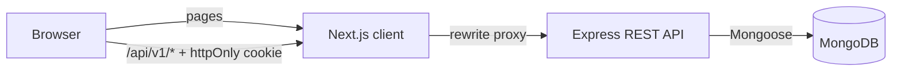
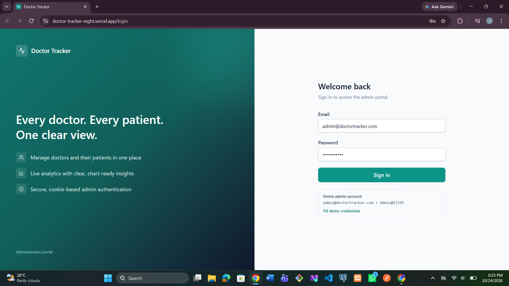
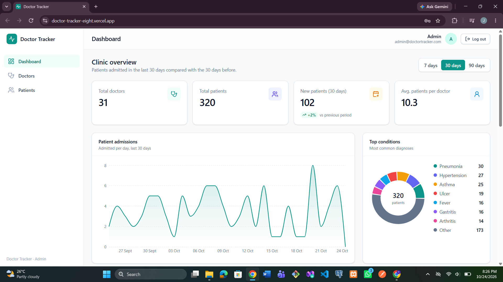
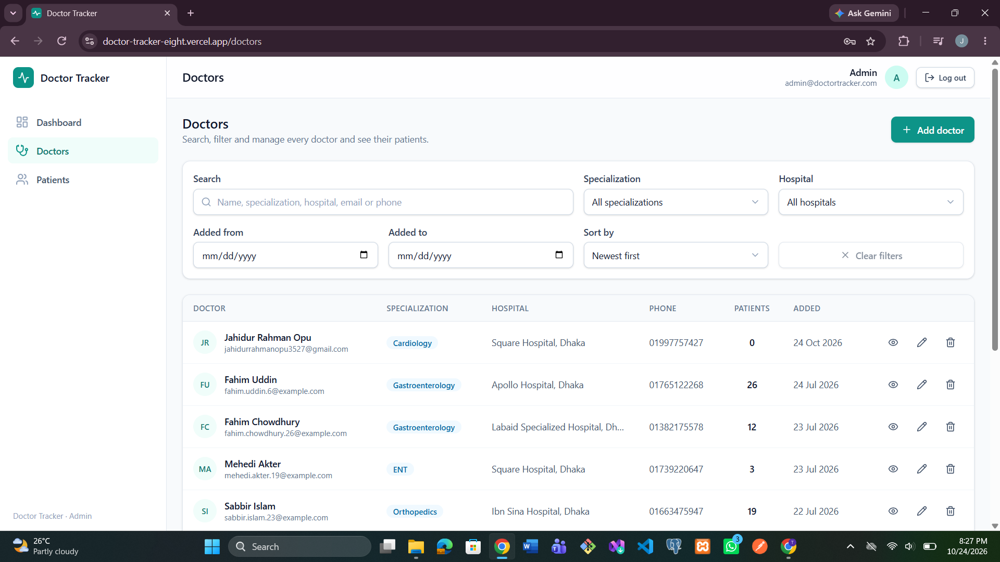
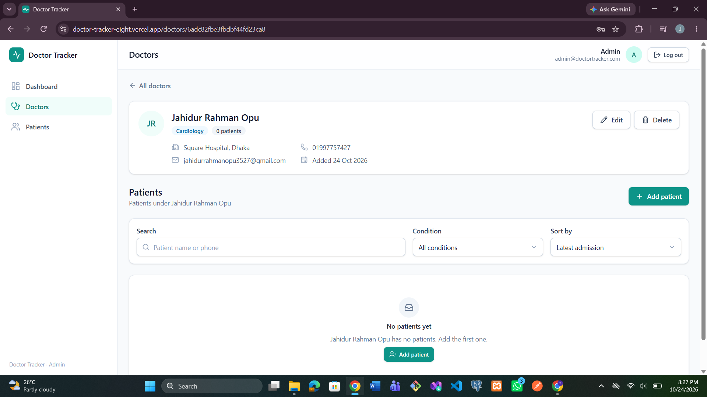
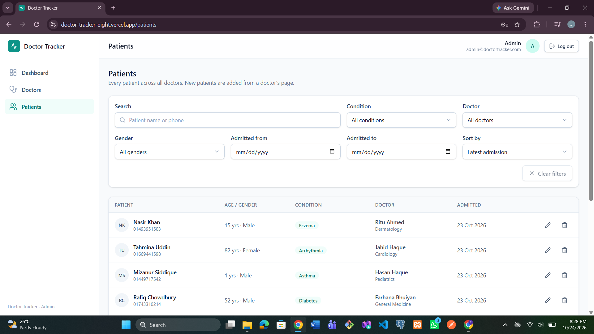
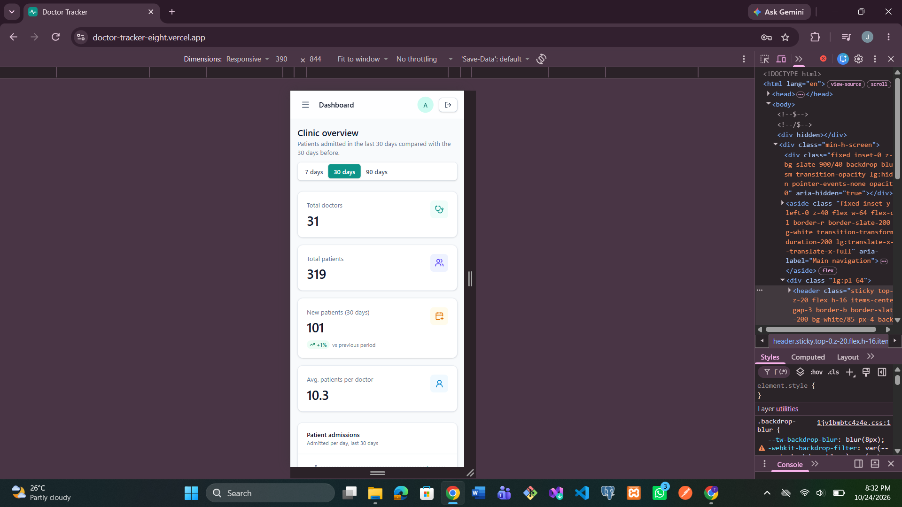
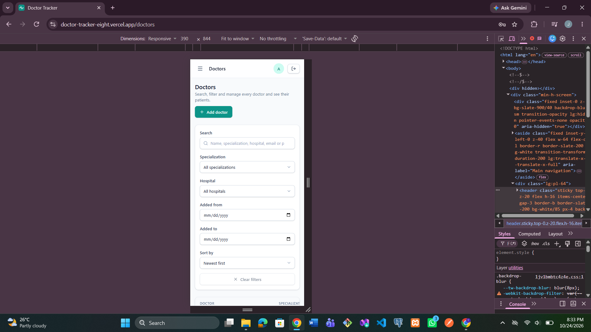
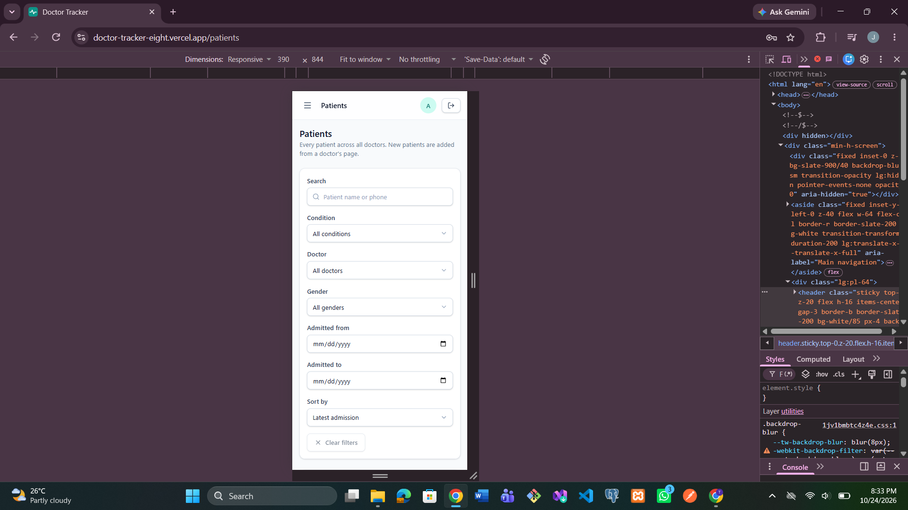
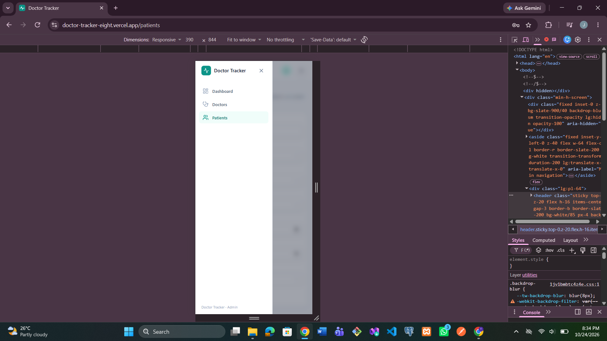

# Doctor Tracker

Doctor Tracker is a secure admin portal for managing doctors and the patients under their care. Authenticated admins can create and search doctors, add or remove patients per doctor, edit patients on a dedicated page, and monitor the clinic through a dashboard with aggregated analytics (totals, patients per doctor, date-based trends, condition and gender breakdowns). It is built as a separate Next.js client and a standalone Express REST API on MongoDB, with the focus on indexed queries, clean UX and a responsive interface.

**Live demo:** https://doctor-tracker-eight.vercel.app
**API health check:** https://doctor-tracker-api-rh81.onrender.com/api/v1/health
**GitHub:** https://github.com/opu02/doctor-tracker

| Role | Email | Password |
|---|---|---|
| Admin | `admin@doctortracker.com` | `<ADMIN_PASSWORD you set>` |

> The API runs on a free Render plan and sleeps when idle, so the first request can take up to a minute.

---

## Features

- **Authentication:** email/password login, JWT stored in an `httpOnly` cookie, all data routes protected (`protect` + `restrictTo("admin")`), login rate-limiting.
- **Doctors:** create, edit, delete (cascades to their patients in a transaction), search, filter by specialization / hospital / date added, sort, paginate.
- **Doctor detail:** see a doctor's patients, add a new patient under them, remove a patient.
- **Patients page:** list all patients, edit (including reassigning to another doctor), delete, search, filter by condition / gender / doctor / admission date, sort, paginate.
- **Dashboard:** total doctors and patients, average patients per doctor, new patients vs the previous period (7 / 30 / 90 days), admissions per day, top 10 doctors by patients, condition donut (top 7 + "Other") and gender donut, doctors by specialization, recent admissions.
- **UX:** responsive layout with mobile drawer, skeleton loaders, empty and error states, toasts, confirm dialogs, filters kept in the URL (shareable, survives refresh).

## Tech stack

| Layer | Technology |
|---|---|
| Frontend | Next.js (App Router), React, TypeScript, Tailwind CSS, TanStack Query, React Hook Form, Zod, Recharts |
| Backend | Node.js, Express, TypeScript, Zod, JWT, bcrypt, Helmet, express-rate-limit |
| Database | MongoDB (Mongoose) |
| API style | REST, JSON, `/api/v1` |

---

## Setup guide

### Prerequisites

- Node.js 20 or newer (the deployed API runs on Node.js 22)
- A MongoDB **replica set** (MongoDB Atlas free tier works). Deleting a doctor uses a transaction, which a standalone `mongod` does not support.

### 1. Clone

```bash
git clone https://github.com/opu02/doctor-tracker.git
cd doctor-tracker
```

### 2. Backend

```bash
cd doctor-tracker-backend
cp .env.example .env        # then fill in the values
npm install
npm run seed                # creates the admin user + 30 doctors / 320 sample patients
npm run dev                 # http://localhost:5000/api/v1
```

`.env` values (see `.env.example`):

| Variable | Description |
|---|---|
| `PORT` | API port (default `5000`) |
| `NODE_ENV` | `development` or `production` |
| `MONGODB_URI` | MongoDB connection string |
| `JWT_SECRET` | Random string, at least 16 characters |
| `JWT_EXPIRES_IN` | Token lifetime, e.g. `7d` |
| `CLIENT_URL` | Frontend origin, e.g. `http://localhost:3000` |
| `ADMIN_EMAIL` / `ADMIN_PASSWORD` | Credentials created by the seed script |

Other scripts: `npm run build`, `npm start`, `npm run seed -- --fresh` (wipe and regenerate sample data).

### 3. Frontend

```bash
cd ../doctor-tracker-frontend
cp .env.example .env.local
npm install
npm run dev                 # http://localhost:3000
```

| Variable | Description |
|---|---|
| `API_URL` | Express server URL, no trailing slash (default `http://localhost:5000`). Read at **build time** by the `/api/*` rewrite. |

Open `http://localhost:3000` and sign in with the seeded admin account.

### Deployment

- **Backend:** Render web service (`https://doctor-tracker-api-rh81.onrender.com`), root directory `doctor-tracker-backend`, build `npm install --include=dev && npm run build`, start `npm start`, with the environment variables above.
- **Frontend:** Vercel (`https://doctor-tracker-eight.vercel.app`), root directory `doctor-tracker-frontend`, environment variable `API_URL=https://doctor-tracker-api-rh81.onrender.com` set before the build.
- `CLIENT_URL` on Render is set to the Vercel URL.

---

## System architecture

The browser only ever talks to the Next.js app. Requests to `/api/*` are proxied by a Next.js rewrite to the Express server, which talks to MongoDB.



**Request flow**

1. `proxy.ts` redirects to `/login` when there is no session cookie.
2. The app shell calls `GET /auth/me`; the API verifies the JWT and that the user still exists.
3. Pages fetch data through TanStack Query hooks (`hooks/use-*.ts`) and the `api()` fetch wrapper.
4. Express validates input with Zod, runs indexed Mongo queries (or aggregations for the dashboard) and returns `{ data, meta }`.
5. After a write, the related queries are invalidated so lists, counts and charts refetch.

**Folder structure**

```
doctor-tracker-backend/src
  config/       env validation, DB connection
  controllers/  request handlers
  services/     shared query logic (patient listing)
  models/       Mongoose schemas + indexes
  validators/   Zod schemas
  middleware/   auth, error handler
  routes/       REST routes
  utils/        search tokens, query helpers, Dhaka time helpers
  scripts/      seed

doctor-tracker-frontend/src
  app/          routes: login, dashboard, doctors, doctors/[id], patients
  components/   ui/ (primitives), layout/, dashboard/, doctors/, patients/, data/
  hooks/        TanStack Query hooks, URL list-state hook
  lib/          api client, types, utils, form helpers
```

## API overview

Base path `/api/v1`. All routes except `/health`, `/auth/login` and `/auth/logout` require authentication.

| Method | Endpoint | Purpose |
|---|---|---|
| GET | `/health` | Health check |
| POST | `/auth/login` | Sign in (sets cookie) |
| POST | `/auth/logout` | Sign out |
| GET | `/auth/me` | Current user |
| GET | `/dashboard/summary?days=7\|30\|90` | Aggregated analytics |
| GET / POST | `/doctors` | List (search, filters, sort, pagination) / create |
| GET | `/doctors/filters` | Values for filter dropdowns |
| GET / PATCH / DELETE | `/doctors/:id` | Read / update / delete (cascades patients) |
| GET / POST | `/doctors/:id/patients` | A doctor's patients / add a patient |
| DELETE | `/doctors/:id/patients/:patientId` | Remove a patient from a doctor |
| GET | `/patients` | List all patients (search, filters, sort, pagination) |
| GET | `/patients/filters` | Condition values for the filter |
| GET / PATCH / DELETE | `/patients/:id` | Read / update / delete |

Success responses are `{ data, meta? }`; errors are `{ error: { message, details? } }` with proper status codes (400, 401, 403, 404, 409).

---

## Technical decisions

### 1. Prefix search on a `searchTokens` multikey index

**Problem:** the usual `{ $regex: /term/i }` search cannot use an index, so it scans the whole collection and gets slower as data grows.

**Decision:** every doctor and patient document stores a `searchTokens` array of lower-case words (name words, specialization, hospital, email and its local part, phone). The search box turns each typed word into an **anchored** regex (`^term`) and requires all words to match, so `abdur rah` finds "Abdur Rahman". Anchored prefix regexes can use the multikey index on `searchTokens`.

**Trade-offs:** search matches word beginnings, not the middle of a word (searching "gmail" will not match an email address). Tokens must be kept in sync, so they are rebuilt in a `pre("validate")` hook and updates go through `doc.save()` instead of `findOneAndUpdate`. In return, search, filters and sorting are all served by indexes: compound indexes such as `{ specialization, createdAt }` and `{ doctorId, admittedDate }` cover the common filter + sort combinations.

### 2. Next.js rewrite proxy with an `httpOnly` cookie

**Problem:** with the client and API on different domains, an auth cookie becomes a cross-site cookie, which needs `SameSite=None`, CORS credentials and is increasingly blocked by browsers. Storing the JWT in `localStorage` would expose it to XSS.

**Decision:** the browser only calls the Next.js origin. A rewrite in `next.config.ts` forwards `/api/*` to the Express server, so the cookie is first-party, `httpOnly` (invisible to JavaScript) and `SameSite=Lax`, which also blocks cross-site state-changing requests. The Next.js `proxy.ts` is only a cheap first gate (cookie present); the API verifies the JWT on every request and re-checks that the user still exists, so a forged cookie never returns data.

**Trade-off:** `API_URL` is baked in at build time, so changing the backend URL needs a frontend rebuild.

### Other choices

- **TanStack Query** for server state (caching, `keepPreviousData` for smooth pagination, targeted invalidation) and **URL search params** for list state (search, filters, page), instead of a global store.
- **Dashboard numbers come from MongoDB aggregations** run in parallel; the browser receives small chart-ready arrays, and `$lookup` runs only on the top 10 doctors.
- **Dhaka time (UTC+6)** is used for day grouping and date filters so "today" matches what admins see.

## Known limitations

- Search is prefix-based (see decision 1).
- Offset pagination (`skip`/`limit`); cursor pagination would suit very large collections better.
- Doctor dropdowns on the patient screens load up to 100 doctors.
- Single role (`admin`); there is no registration flow by design.

---

## Screenshots

### Desktop

| Login | Dashboard |
|---|---|
|  |  |

| Doctors | Doctor detail |
|---|---|
|  |  |

| Patients |
|---|
|  |

### Mobile

| Dashboard | Doctors | Patients | Menu |
|---|---|---|---|
|  |  |  |  |